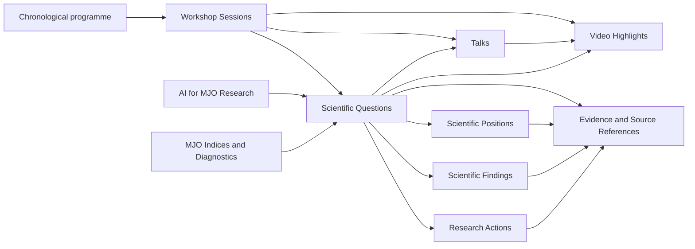

# Phase 3 — 科学的知識アーキテクチャ

実装日: 2026-11-01〜2026-11-02（Asia/Tokyo）。契約版: **1.0.0**。

既存の EmDash / Astro アプリケーションに、8コレクション・124フィールド・24参照関係を追加した。ローカルCMSに実際に適用したのはスキーマと2つのトピック定義だけであり、科学的レコードは0件である。既存の Posts / Pages は保持した。

この文書が Phase 3 の設計・実装記録である。Phase 2 の README、IMPLEMENTATION_PLAN、VERIFICATION は当時の記録として保持している。[今回の検証結果](PHASE3_VERIFICATION.md)を併せて参照する。

## 1. コレクションと責務

| コレクションID | CMS表示名 | 内容・関係 |
| --- | --- | --- |
| `workshop_sessions` | Workshop Sessions | セッション種別、開始・終了日時、IANAタイムゾーン、公式プログラム順、プログラム出典、主張単位の要約 |
| `talks` | Talks | 1セッションに所属する個別講演。プログラム順・公式プログラム出典・確認できた登壇者名・要約 |
| `video_highlights` | Video Highlights | 1セッション、任意の1講演に対応するハイライト。YouTube ID、代表版、対応関係の根拠、目視・権利・対応確認 |
| `scientific_questions` | Scientific Questions | 複数セッションを横断する問い。背景・立場・根拠・不確実性・解釈・講演・動画・提案・知見を結ぶ中心 |
| `scientific_positions` | Scientific Positions | 1つの問いについての仮説・解釈・研究手法。支持／反証の根拠を分離し、複数セッションの寄与を参照 |
| `evidence_references` | Evidence and Source References | 文書の特定版の特定箇所。source ID・版・SHA-256・種類・レビュー状態、セッション、箇所指定、寄与ID、帰属、検証状態 |
| `scientific_findings` | Scientific Findings | 出典付きの知見。主張の種類を保持し、観測・解釈・合意を区別。複数の問い／セッションを参照 |
| `research_actions` | Research Actions | 問いから導く例示的なAIエージェント作業案。根拠、手順、想定出力、限界。担当者・締切・進捗・実施済みを表すフィールドは設けない |

全レコード共通: `external_id`、`record_version`、`title`、`topic_ids`、`coverage`、科学レビュー／公開承認／英語レビュー。

`external_id` はエクスポート元が管理する安定IDであり、全コレクションを通じて一意とする。EmDashのULIDや公開スラッグとは別物である。CMS側にも一意制約を設けた。

## 2. 関係と2つの閲覧軸



- **時系列**: セッションの開始時刻を絶対時刻として比較し、同時刻ならプログラム順と安定IDで順序を決める。講演はセッション内のプログラム順。表示用タイムゾーンと収録範囲を保持する。
- **テーマ別**: 問いのトピックから入り、関連セッション・立場・根拠・講演・動画・提案へ進む。1つの問いを複数セッション／複数トピックに紐付けられる。
- `navigationIndexes()` はこの2種類の索引を同じ検証済みグラフから生成する。テストではセッション配列を逆順にしても時系列が保たれ、同じ問いを複数トピック／複数セッションから辿れることを確認する。
- `/program`、`/questions`、`/topics/[topic]` はサーバー描画の入口を実装した。現段階では未取り込みであることを明示する空表示であり、CMSデータを読む完成版の科学的詳細ページではない。テスト資料を画面表示する経路はない。

**トピックは2つの独立した第一級分類**として `scientific_topic` タクソノミーに登録する。

| 安定トピックID | 英語表示名 |
| --- | --- |
| `ai_for_mjo_research` | AI for MJO Research |
| `mjo_indices_and_diagnostics` | MJO Indices and Diagnostics |

この版では両者を一つのAI／診断カテゴリに統合しない。新しいトピックの追加も契約変更としてレビューする。`topic_ids` が輸送形式の正本、CMSタクソノミー割当がその投影であり、将来の書き込み処理は同時に同期する。

24のコレクション間参照はネイティブの EmDash relations と reference fields を使う。単一リンクの最大数は1、それ以外は複数。リンク先コレクション・存在・問いへの逆参照・セッションの整合性を輸送契約側でも確認する。主張内の出典IDはJSON内部に残し、独自IDをEmDashのIDに見せかけない。

## 3. 科学的な問いの8要素

| 要求要素 | 格納先 |
| --- | --- |
| Background | `background[]`（主張オブジェクト） |
| Competing hypotheses | `position_ids[]` → Scientific Positions。`position_kind=hypothesis` が仮説を表す |
| Supporting evidence | `supporting_evidence_ids[]` および各主張の `evidence_ids[]` |
| Uncertainties | `uncertainties[]`、各主張の `uncertainty`、レコードの `coverage.limitations` |
| Scientific interpretation | `scientific_interpretation[]` |
| Related presentations | `talk_ids[]` |
| Related videos | `video_ids[]` |
| Proposed research actions | `action_ids[]` |

フィールドの省略は拒否するが、資料に存在しない項目の空配列は許す。空欄を埋めるために内容を再構成しない。収録状態は `complete / partial / missing` と限界説明で保持し、`missing` とした記録に主張を入れることは拒否する。網羅性が不明なら `partial` と具体的な限界を記す。

## 4. 議論分類

| 値 | 表示名 | 定義と機械的条件 |
| --- | --- | --- |
| `diverging_perspectives` | Diverging Perspectives | 解釈・仮説・研究手法の実質的な相違。少なくとも2立場と、独立した寄与IDを持つ2出典が必要 |
| `emerging_alignment` | Emerging Alignment | 複数の寄与が共通の理解／方向へ近づいている状態。2立場・2寄与以上を要求するが、合意とは扱わない |
| `open_questions` | Open Questions | 合意や対立を判断する証拠が不足した未解決事項。未解決との分類自体にも記録上の根拠が必要 |
| `documented_agreements` | Documented Agreements | ワークショップ記録に明示された結論・決定。レビュー済み議事録の合意箇所を必須とする |

分類は `classification_basis` という出典付きの主張として保存する。前3分類は編集上の解釈、最後は `kind=documented_agreement` とする。複数寄与の分類理由は、それぞれの立場の根拠を実際に引用参照する必要がある。

**沈黙や反対意見がなかったことから合意を推定しない。** `explicit_agreement` の出典がなければ合意の主張・分類を拒否する。ただし、その箇所が本当に合意を意味するか、相違が実質的か、収束が見られるかは人による原記録レビューが必要である。複数出典という数だけでは科学的判断を自動確定しない。

## 5. 主張単位の来歴

主張は裸の文章ではなく、次の構造で保存する。

```text
claim_id, text, kind, evidence_ids[], session_ids[],
attribution { mode, talk_id }, verification, uncertainty
```

`kind`: `observation / hypothesis / interpretation / proposal / documented_agreement`。

`verification`: `unverified / verified / disputed`。ここで verified は「その内容をその記録から述べてよいと確認した」ことを表し、仮説が実証済みであることや解釈が唯一正しいことを意味しない。

すべての主張は1件以上の出典とセッションを必要とする。各セッションに対応する特定箇所の出典を要求し、関係のないセッションの根拠を混ぜることは拒否する。出典文書の同一ID・同一版で異なるハッシュも拒否する。

`evidence_references` の1行は「文書そのもの」ではなく「文書の版と、その中の1箇所」である。同じ文書の複数箇所には別の evidence ID を付ける。文書ID・版・ハッシュは各行に保持し、セッション横断の解釈がどの記録のどの部分に依拠したか辿れるようにする。

`passage.locator` は節番号・段落ID・時刻範囲などの箇所指定、`passage.description` は承認済みの短い説明。原文の大量引用、未加工の議事録・書き起こし・ファイルパスを輸送しない。文書タイトルやsource IDは識別用であり、ダウンロードリンクではない。

氏名は `talks.speaker_names` のみ。個別講演の公式プログラム箇所を要求する。主張の帰属は該当講演IDで参照し、議論セッションへの氏名帰属は拒否する。`contribution_id` は匿名の寄与を区別する識別子であり、氏名や個人を推測するものではない。

## 6. 版管理付きレビュー済JSON（インポート契約）

機械可読定義: [scientific-import-v1.schema.json](../schemas/scientific-import-v1.schema.json)。定義の正本は [contract.mjs](../src/science/contract.mjs)。JSON Schema 2020-12形式で出力する。

トップレベルは `format`, `schema_version`, `purpose`, `producer`, `export_id`, `exported_at`, `language`, `records`。形式名は `mjo-workshop-reviewed-content`、`producer` は `editorial_export`、言語は `en` に固定する。`producer` はスキーマ上の固定トークン（レビュー済エクスポートの出所ラベル）であり、他リポジトリへの依存やリンクを意味しない。

- 現版は厳密に `1.0.0` のみを受理し、未知の版・未知フィールドを黙って無視しない。
- `records` は8コレクションの配列を必ず含む。空配列は許す。
- 参照対象をすべて同じJSONに含める、参照が閉じたエクスポートとする。未知の既存CMSデータで不足を自動補完しない。
- importerは本リポジトリ外の編集作業ツリーを読み取らない。オフラインでレビューした公開用派生物だけを、利用者が明示したJSONとして渡す。依存・submodule・symlink・ビルド時入力を追加していない。
- 原本・原写真・録画・URL・ローカルパス・HTMLは契約に含めない。この版では公開論文URLも持たず、文書識別子による来歴を優先する。
- YouTubeは11文字のIDのみ。`video_kind=highlight`、対応の出典・代表版・目視・権利・対応確認が揃うことを要求する。文字数の検査だけではYouTube上の実在や内容一致を証明できないため、オフラインでの人による確認が必要。

各レコードには科学レビュー・公開承認・英語レビューの3記録を要求する。それぞれ承認状態、レビュアー識別子、承認日時、対象レコードのSHA-256を持つ。`recordDigest()` はこの3つの承認記録を除いた全フィールドをキー順に正規化してハッシュ化する。本文・版・参照・収録範囲の変更後に古い承認を流用すると検証に失敗する。

これらは**レビュー記録の整合性検査**であり、レビュアー本人確認や電子署名の仕組みではない。承認日時がエクスポート後なら拒否する。英語であるとの自己申告だけでなく、対象ハッシュに結び付いた英語レビューを要求するが、文章の意味や英語品質を機械的には証明しない。

### 事前検査と再取り込み

```sh
npm run science:validate -- /path/to/reviewed-export.json
npm run science:plan -- /path/to/reviewed-export.json
npm run science:plan -- /path/to/reviewed-export.json /path/to/previous-reviewed-export.json
```

上記は読み取り専用。現在の実装は **検証とdry-run計画まで**で、科学的レコードの実書き込み／公開コマンドはない。計画は本文をログに出さず操作種別・ID・ハッシュを報告する。

`prepareImport()` の返すデータは、通常フィールドとネイティブ参照を分離している。将来の実行側は2段階で全external IDをCMS IDに解決してから参照を書き込む。生成計画をそのままEmDash seedやCLIのcontent createに渡してはいけない。

| 状況 | 計画の扱い |
| --- | --- |
| 新規ID | `create_draft` |
| 同一ID・同一版・内容／承認も同じ | `skip` |
| 同一版で内容や承認が変わる | 衝突として拒否 |
| 版が増える | `update_draft` |
| 版が戻る／IDのコレクションが変わる | 拒否 |
| 前回にあったIDが今回ない | 保持。削除と解釈しない |

元環境が科学的本文の正本。CMSで本文を編集する場合は元環境へ戻して版と承認を更新し、再取り込みする。出典差し替え時は依存する主張の再レビューも必要。将来の実書き込みではCMS内の変更と `expected_previous_sha256` を照合し、競合を黙って上書きしない。現時点の計画比較は前回JSONとの比較であり、CMSの現状態を照会するものではない。

## 7. 公開防止と編集境界

`publication-policy.mjs` を実際のEmDash設定に登録した。Phase 3中は8コレクションすべての公開と予約公開を拒否する。CMS編集画面の承認チェックだけでこの制限を解除しない。通常の下書き保存は可能であり、ネストしたJSONの厳密な意味／グラフ検証は取り込みバリデータが担う。

公開ポリシーはローカルのnative pluginとして同梱する。Nodeアプリのホスト側設定と同じ管理範囲で、外部プラグインパッケージやネットワーク権限を追加しない。実際の8コレクションに対する公開・予約公開拒否を、隔離したメモリ内DBとEmDash実装で検証する。

この制限はEmDashの公開処理を通る経路を対象とする。手動SQL、直接seed投入、ホスト権限のプラグインコードを安全な科学的取り込み経路として扱ってはいけない。科学コレクションはsearch／SEO／preview／schedulingを有効にせず、現段階のフロントエンドにも科学的本文を表示する経路を設けていない。

実データの取り込み実行・承認者認証・出典差し替えの依存レビュー・公開許可・詳細画面は後続段階で実装／確認する。公開ゲートを外すことと外部デプロイは別の操作であり、いずれも本Phaseでは実施していない。

## 8. テスト資料と再生成

[代表JSON](../tests/fixtures/scientific-architecture-v1.json) は構造テスト専用。すべて `TEST ONLY` と表示し、架空の構造を2000年のテスト日付で示す。実在する科学的結論、人物、録画IDを作っていない。8種のレコード、4分類、2トピック、相互参照をカバーする。

`purpose=test_fixture` は明示的な fixture 検証だけで許可し、通常のvalidate／planでは拒否する。CMSのseedにはレコードを含めず、テストJSONを `public/` やビルド入力へコピーしない。

```sh
node_modules/.bin/node scripts/science.mjs fixture tests/fixtures/scientific-architecture-v1.json
npm run science:check
npm run test:science
node_modules/.bin/node --import ./tests/science-runtime-register.mjs tests/science-runtime.mjs
```

標準ライブラリと既存EmDashのみを使用し、依存パッケージの追加はない。ローカルバリデータはこの契約で使用するJSON Schemaキーワードだけを実装し、汎用JSON Schemaエンジンとは位置付けない。契約変更時には生成JSON／EmDash seedの一致テスト、拒否条件のテスト、実EmDash適用テストを更新する。

`scripts/science.mjs generate` は既存出力を上書きしない。版を更新するときは差分と移行方針をレビューし、元ファイルを保持したうえで新しい版を生成する。未知の版の自動移行はない。

## 9. ローカルスキーマ適用と保持方針

変更前の4ファイル・生成型定義・SQLiteの整合的バックアップを `backups/phase3-before-integration/` に保存した。暗号鍵はコピーしていない。バックアップはGit対象外であり、元ファイルが未追跡なので自動削除しない。

`seed/science-schema-v1.json` は追加スキーマ専用で、既存の設定・メニュー・ウィジェット・科学的コンテンツを含まない。既存DBに対して `--on-conflict skip` で適用し、2トピックの用語を追加した。新規サイト用の `seed/seed.json` にも同じ定義を統合した。EmDashの型定義は再生成済み。

スキーマの変更に `skip` を再使用しても既存定義は更新されない。将来のスキーマ変更では、ローカルのコピーでの移行・既存レコード整合性・復元確認を別途実施する。

## 10. 公式仕様確認

公式ドキュメントMCPの `search_docs` と、インストール済みEmDash 1.4.0の実装・型定義を照合した。

- [Seed format / validation / apply behavior](https://docs.emdashcms.com/themes/seed-files/)
- [Collections and fields](https://docs.emdashcms.com/concepts/collections/)
- [Relations](https://docs.emdashcms.com/guides/relations/)
- [Hook reference](https://docs.emdashcms.com/reference/hooks/)
- [Documentation MCP](https://docs.emdashcms.com/docs-mcp/)

公式seedの構造検査だけでは、任意JSONや科学的レビュー、出典の一致を検証できない。そのためEmDashスキーマと、独立した輸送契約／意味・参照検証を組み合わせた。
