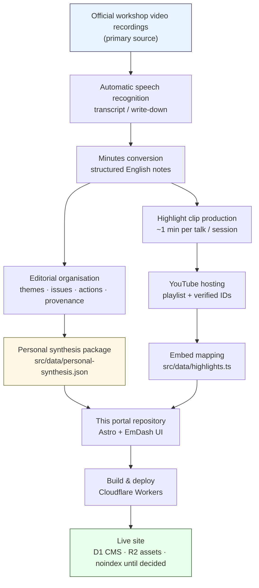
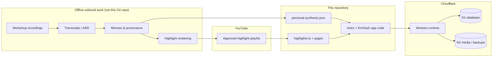
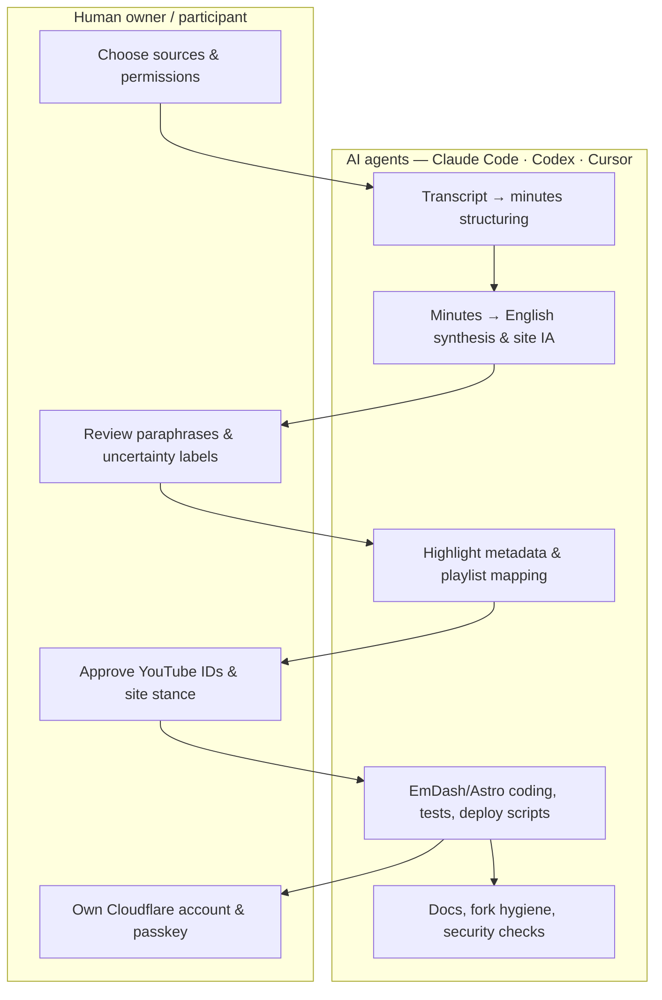
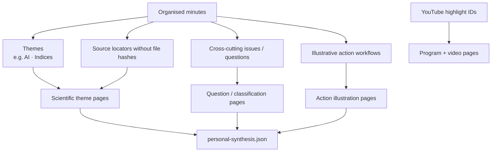
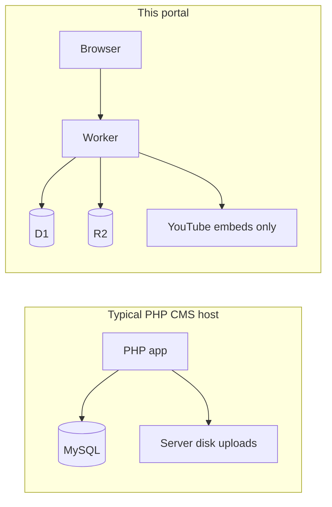
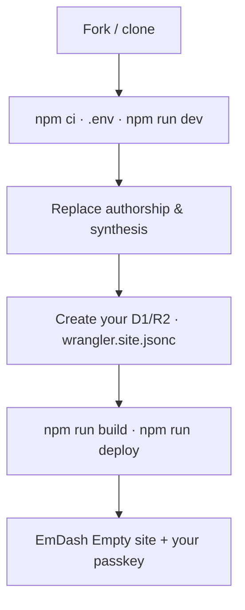

# How this site was created (and how to reuse the repository)

English guide for workshop participants and forks.  
This document explains the **end-to-end workflow** from official workshop recordings to a Cloudflare-hosted EmDash site, and which parts belong in **this** repository versus offline editorial work kept outside Git.

Related: [`README.md`](../README.md) · [`FORKING.md`](./FORKING.md) · [`OWNER_ACCESS_POLICY.md`](./OWNER_ACCESS_POLICY.md) · [`PHASE7_DEPLOYMENT_GUIDE.md`](./PHASE7_DEPLOYMENT_GUIDE.md)

---

## 1. One-sentence summary

**Workshop video recordings → automatic speech recognition (transcript) → structured meeting minutes → one-minute highlight clips on YouTube → personal site structure and English synthesis → EmDash on Cloudflare Workers (no PHP).**  
AI coding agents (Claude Code, Codex, Cursor) assisted the conversion, packaging, and site construction; scientific responsibility and publication permission remain with the human author.

---

## 2. End-to-end flowchart

### What each stage means

| Stage | Input | Output | Where it lives |
| --- | --- | --- | --- |
| Workshop recordings | Official session video | Full-length media | Workshop / ICTP side (not in this repo) |
| Automatic speech recognition | Audio / video | Machine transcript | Outside this repository only |
| Minutes conversion | Transcript | Structured minutes (still imperfect; needs human review) | Outside this repository only |
| Highlight generation | Minutes + video | ~1 minute clips | Produced offline; **published only on YouTube** |
| Site packaging | Reviewed / personal paraphrases | JSON + Astro routes | **This repository** |
| Hosting | Built Worker | Public URL | **Your** Cloudflare account |

**Important:** Raw transcripts, rapporteur notes, PDFs, DOCX, PPTX, and original photographs are **not** committed or served by this site. Only English derivatives and YouTube embeds appear here.

---

## 3. Systems map (who owns what)

| System | Role |
| --- | --- |
| Offline editorial work | Heavy lifting on video, ASR, minutes, provenance, clip rendering. Stays **outside** this repo (no submodule, no credential sharing). |
| This Git repository | Site application, forkable template, bundled personal synthesis, YouTube ID maps, docs. |
| YouTube | Only place full highlight **video files** are hosted for the public site. |
| Cloudflare | Serverless host: Workers + D1 + R2 + encryption secret. No classic PHP/LAMP stack. |

---

## 4. AI agent roles in the pipeline

Agents accelerate conversion and engineering; they do **not** replace scientific sign-off or workshop consensus.

| Agent use | Typical tasks in this project |
| --- | --- |
| Claude Code / Codex / Cursor | Turn ASR text into draft minutes; build theme/issue/action JSON; implement Astro pages; wire EmDash; write verification scripts; prepare Cloudflare config; draft English docs. |
| Human | Confirm permissions; reject over-claims; keep discussion speakers anonymous; decide personal-report vs official product; hold encryption keys; complete EmDash setup with a passkey. |

Minutes used on the site are often **derived from automatic speech recognition**. Expect possible mis-hearings, speaker confusion, and partial coverage. Labels such as “personal synthesis” and “not workshop consensus” are deliberate.

---

## 5. From minutes to site information architecture

Runtime content for the scientific sections is loaded from `src/data/personal-synthesis.json` (see also `examples/` for an empty starter and a reference package).  
Program highlights are mapped in `src/data/highlights.ts` and embedded with click-to-load / `youtube-nocookie` patterns.

---

## 6. Why EmDash on Cloudflare (and no PHP)

The portal is built as a modern **Jamstack / serverless CMS** stack:

| Choice | Reason |
| --- | --- |
| **EmDash** | Astro-based CMS with admin UI, collections, and publication controls. |
| **Astro (`output: "server"`)** | Server-rendered English pages; CMS content is not a static dump of private files. |
| **Cloudflare Workers** | Edge execution without operating a PHP application server. |
| **D1** | Managed SQL for CMS state (users, content), separate from Git. |
| **R2** | Approved site assets and EmDash JSON backups—**not** a public dump of workshop PDFs/videos. |
| **Passkeys + `EMDASH_ENCRYPTION_KEY`** | Admin auth bound to the site origin; secrets stay in Wrangler secrets / local `.env`, never in Git. |
| **Publication policy plugin** | Extra gate so “CMS publish” alone cannot release unverified scientific collections. |

Security / privacy habits enforced in this repo:

- Dev server binds to **localhost** only unless you deliberately change that.
- `.env`, `wrangler.site.jsonc`, `data.db`, `exports/`, `backups/` are gitignored.
- Private path probes (`/exports/…`, `/.env`, `/data.db`) are denied.
- Videos are **never** stored in R2 for playback; only YouTube IDs are embedded.
- Public synthesis packages **omit** SHA-256 fingerprints of private minute files.

This is “high security” in the sense of a **small attack surface and secret hygiene**, not a claim of formal certification.

---

## 7. How to use **this** repository

### A. Read-only understanding

1. Skim this document and [`OWNER_ACCESS_POLICY.md`](./OWNER_ACCESS_POLICY.md).
2. Run locally (`README.md`) to see routes and admin.
3. Inspect `src/data/personal-synthesis.json` and `src/pages/` for structure—not as official workshop minutes.

### B. Fork and make your own site

Follow [`FORKING.md`](./FORKING.md): new encryption key, your authorship in `portal.ts`, your synthesis JSON, your Cloudflare resources, your passkey.

### C. Reproduce the **content** pipeline (outside Git)

If you want a similar *personal* report from recordings you are allowed to use:

1. Obtain lawful access to the session recordings.
2. Run ASR → edit into minutes (expect errors; label uncertainty).
3. Optionally produce short highlights; upload to **your** YouTube account with clear permission.
4. Have agents help draft English synthesis JSON in the shape of `examples/personal-synthesis.empty.json`.
5. Keep raw media and transcripts **out** of this repository and out of `public/`.
6. Only then wire IDs into `highlights.ts` and deploy to **your** Worker.

Do not copy another person’s D1 database ID, encryption key, or admin account.

---

## 8. Honest limits (please keep these visible)

- The live owner site is a **personal participation report**, not an ICTP official product and not multi-author consensus.
- ASR-derived minutes can mis-hear numbers, names, and causality.
- Action pages are **illustrative AI workflows**, not assigned tasks or proof of completed work.
- Named attribution is for programme-listed individual talks only; discussion sessions stay anonymous on the site.
- GitHub visibility (private vs public) is independent of whether a Cloudflare URL is reachable.
- Search indexing (`noindex`) and custom domains are separate owner decisions.

---

## 9. Quick glossary

| Term | Meaning here |
| --- | --- |
| **ASR** | Automatic speech recognition — machine transcript from audio/video. |
| **Minutes** | Structured notes derived from transcripts (often still draft). |
| **Personal synthesis** | Author’s English packaging of minutes for the site, with uncertainty labels. |
| **Highlight** | Short YouTube clip (~1 min), not the full session recording. |
| **EmDash** | CMS integrated with Astro used by this portal. |
| **Worker** | Cloudflare serverless process that serves the site. |

---

## 10. Document maintenance

Update this file when the pipeline stages, hosting stack, or fork rules change.  
Do not paste production D1 UUIDs, encryption keys, or private email addresses into this guide.

Owner-only Japanese review copies under `docs/*.ja.md` are listed in `.gitignore` and must not be committed. The public guide remains English-only.
